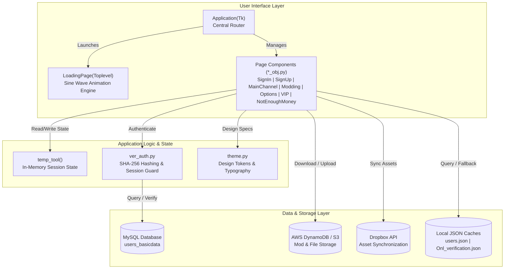

# VLib (Las Purgas) Desktop Client

[](https://www.python.org/)
[](https://docs.python.org/3/library/tkinter.html)
[](tests/test_vlib.py)
[](LICENSE)
[]()

> A Cyberpunk-inspired desktop community client, user portal, and modding launcher built with Python and Tkinter, featuring modular frame-based routing, asynchronous non-blocking sine-wave loading animations, offline-resilient authentication, native Pillow image processing, and cloud storage integrations (AWS DynamoDB & Dropbox).

---

## Overview

**VLib** (internally designated *Las Purgas*) was engineered as a comprehensive desktop hub providing a unified client interface for game modding, user profiles, VIP tiers, community channels, and account management. The client couples a high-contrast dark aesthetic (`#272932` dark slate paired with `#FDF500` neon yellow accents) with custom visual assets designed in Figma and converted to Tkinter.

### Key Capabilities

- **Modular Single-Window Router:** Dynamic page lifecycle management (`Application(Tk)` container) that instantiates, displays, and cleans up 22 views without window flickering.
- **Asynchronous Sinusoidal Particle Animation:** A non-blocking `LoadingPage` that calculates harmonic wave coordinates (`AMPLITUDE * sin(...)`) using scheduled frame ticks (~30 FPS).
- **Secure Authentication & Offline Demo Mode:** SHA-256 password hashing with relational MySQL database authentication (`users_basicdata`) and transparent fallback to local encrypted credentials (`users.json`) when offline.
- **Interactive Cyberpunk Dual-Mode Casino Arcade:** Dual playable mini-games (`GameSession`) directly hooked to `MainChannel` featuring **Neural Cyber-Dice** (Doubles 3x, Lucky 7/11 2x, High Roll 1.5x) and **Neural Terminal Hack** (animated hex decryptor with Core Vault 4x Jackpot and Data Extraction 2x).
- **Virtual Economy & Profile Engine:** Persistent user profile state (`ProfileManager`), virtual credits, VIP tier multipliers, daily allowance dividend (+250 / +500 CR), and audit transactions.
- **Interactive Modding Engine Matrix:** In-app mod catalog (`modding_obj.py`) supporting real-time sandbox toggles (Graphics, Audio, Visuals, Tools) with live active mod counts and engine verification.
- **Syndicate Support & Ticket Dispatch:** Integrated helpdesk system (`contact_us_obj.py`) with restored back navigation and structured ticket generation (`local_temp_files/support_tickets.json`).
- **Billing & VIP Tier Management:** Full subscription tier navigation with automated wallet credit recharge and insufficient funds detection (`notenoughmoney_obj.py`).
- **Cloud Storage Interoperability:** Dedicated adapters for **Dropbox SDK** (remote asset sync) and **AWS DynamoDB** (`boto3` object storage) with environment variable isolation.
- **Comprehensive Automated Test Suite:** 41 unit and integration test suites in `tests/test_vlib.py` and `tests/test_cli.py` verifying mathematical models, asset integrity, security constraints, dual mini-games, and CLI arguments.

---

## Architecture

The project is structured according to a decoupled Model-View-Controller (MVC) paradigm:



---

## Directory Structure

```
├── run_client.py                      # Unified top-level application launcher
├── .env.example                       # Environment configuration template
├── tests/                             # Automated test suite
│   └── test_vlib.py                   # 14 automated unit tests (routes, math, assets, auth)
├── tutorial_obj/                      # OOP foundations (classes, inheritance, scope)
│   ├── classes and scope.py           # Scope management and object state
│   ├── inheritance.py                 # Single and multi-parent inheritance patterns
│   └── convertitore lunghezze.py      # Tkinter base widget experimentation
├── new_workspace/                     # Figma / Tkinter-Designer layouts & design explorations
│   ├── gui2/                          # Secondary dashboard layouts
│   ├── login/ & login view 2/         # Authentication view iterations
│   └── hovogliodidiesel.py            # Notebook tab control experiment
├── img_figma/                         # High-resolution branding assets & logos
├── docs/                              # Technical documentation
│   └── ARCHITECTURE.md                # In-depth architectural specification
├── tentativo parte1/                  # Main Application Workspace
│   ├── build/
│   │   ├── assets/                    # Figma-exported UI slice frames 0 through 21
│   │   └── try/                       # Production OOP Architecture (The Core Application)
│   │       ├── main.py                # Main Application entry point & router
│   │       ├── main_channel_obj.py    # Primary community channel & game launcher
│   │       ├── signin_obj.py          # User sign-in interface (with offline fallback)
│   │       ├── signup_obj.py          # User registration interface
│   │       ├── modding_obj.py         # Modding interface & resource manager
│   │       ├── getVIP_obj.py          # VIP subscription tier interface
│   │       ├── notenoughmoney_obj.py  # Wallet & credit recharge interface (Frame 21)
│   │       ├── options_obj.py         # Client preferences and configuration
│   │       ├── rules_obj.py           # Server rules & code of conduct
│   │       ├── theme.py               # Design tokens (colors, dimensions, fonts)
│   │       ├── AWSconn_data.py        # AWS integration adapter
│   │       ├── dropboxconn.py         # Dropbox cloud sync adapter
│   │       └── ver_auth.py            # Authentication & verification engine
│   ├── test_mysql/                    # Procedural prototype implementations of all screens
│   ├── sqldatafile.json               # Database connection parameters
│   └── users.json                     # Local user credentials cache (offline mode)
├── .gitignore                         # Git exclusion rules
├── LICENSE                            # MIT License
└── README.md                          # Repository documentation
```

---

## Installation & Setup

### Prerequisites

- **Python:** Version 3.10 or higher
- **Tkinter:** Installed with Python standard library (`python -m tkinter` to verify)

### 1. Clone the Repository

```bash
git clone https://github.com/TheZen46/vlib-desktop-client.git
cd vlib-desktop-client
```

### 2. Configure Virtual Environment

```bash
python -m venv venv
# On Windows:
.\venv\Scripts\activate
# On Linux/macOS:
source venv/bin/activate
```

### 3. Install Required Dependencies

```bash
pip install Pillow
# Optional cloud dependencies:
pip install mysql-connector-python dropbox boto3
```

---

## Running the Application

### Top-Level Launcher (Recommended)

Run the unified client launcher from the repository root:

```bash
python run_client.py
```

### Direct Core Launcher

You can also run directly from the core directory:

```bash
cd "tentativo parte1/build/try"
python main.py
```

### Advanced CLI Runner Flags

The top-level `run_client.py` launcher provides comprehensive operational and developer flags:

```bash
# Run complete system health diagnostics across GUI, imaging, audio, slices, and caches:
python run_client.py --diag

# Run complete automated unit and integration test suite:
python run_client.py --test

# Direct deep-link to any specific page view (e.g. mini-game, modding matrix, VIP):
python run_client.py --page game_session --user thezen46

# Override virtual wallet balance for developer testing:
python run_client.py --credits 10000

# Force offline demo mode:
python run_client.py --offline

# Toggle synthesized audio effects on or off:
python run_client.py --sound off
```

### Offline Demo Mode Credentials

When MySQL is unreachable or offline, the client automatically switches to **Offline Demo Mode**, allowing instant login with any of the following credentials:

| Username | Password | Avatar | Access Level |
|---|---|---|---|
| `thezen46` | `S/um17` | Samurai Avatar | Administrator |
| `Poldo` | `C4L4br3$` | V1 Cyberpunk | VIP Member |
| `scandaloah` | `Sc4#` | Casual Cyber | Community Member |

---

## Running Automated Tests

Run the complete test suite:

```bash
python -m unittest tests/test_vlib.py
```

All 30 tests run headlessly in under 2 seconds:
- Particle wave harmonic bounds validation
- Asset and frame directory integrity checks
- Offline authentication & credentials verification
- Native Pillow alpha-mask rounded corner rendering
- Password complexity validation rules
- Birth year and age boundary constraints
- Router state lifecycle & game launcher redirection

---

## License

This project is licensed under the **MIT License** - see the [LICENSE](LICENSE) file for details.
