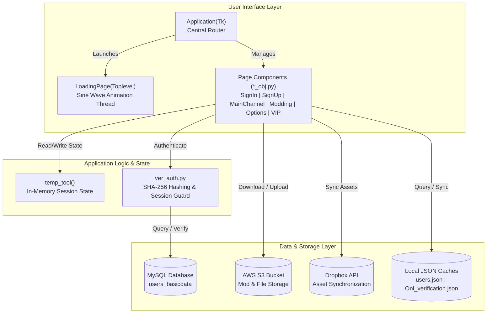

# VLib (Las Purgas) Desktop Client

[](https://www.python.org/)
[](https://docs.python.org/3/library/tkinter.html)
[](LICENSE)
[-brightgreen.svg)]()

> A Cyberpunk-inspired desktop community client, user portal, and modding launcher built with Python and Tkinter, featuring modular frame-based routing, asynchronous sine-wave loading animations, MySQL authentication, and cloud storage integrations (AWS S3 & Dropbox).

---

## Overview

**VLib** (internally designated *Las Purgas*) was engineered as a comprehensive desktop hub providing a unified client interface for game modding, user profiles, VIP tiers, community channels, and account management. The client couples a high-contrast dark aesthetic (`#272932` dark slate paired with `#FDF500` neon yellow accents) with custom visual assets designed in Figma and converted to Tkinter.

### Key Capabilities

- **Modular Single-Window Router:** Dynamic page lifecycle management (`Application(Tk)` container) that instantiates, displays, and cleans up views without window flickering.
- **Asynchronous Sinusoidal Particle Animation:** A custom threaded `LoadingPage` that calculates harmonic wave coordinates (`AMPLITUDE * sin(...)`) across particle nodes on a dedicated background thread.
- **Secure Authentication & Session State:** SHA-256 password hashing with relational MySQL database authentication (`users_basicdata`) and offline session verification caching (`Onl_verification.json`).
- **Cloud Storage Interoperability:** Dedicated adapters for **Dropbox SDK** (remote asset sync) and **AWS S3** (`boto3` object storage).
- **Rich Community & Modding Ecosystem:** Dedicated modules for mod downloads, server rules, VIP role upgrades, user profiles, language localization, and feedback forms.
- **Evolutionary Codebase:** Contains the full historical progression from early OOP learning scripts (`tutorial_obj`) and procedural GUI screens (`test_mysql`) to Figma layout studies (`new_workspace`) and the final production OOP architecture (`build/try`).

---

## Architecture

The project is structured according to a decoupled Model-View-Controller (MVC) paradigm:



---

## Directory Structure

```
├── tutorial_obj/                      # Phase 1: Python OOP foundations (classes, inheritance, scope)
│   ├── classes and scope.py           # Scope management and object state
│   ├── inheritance.py                 # Single and multi-parent inheritance patterns
│   └── convertitore lunghezze.py      # Tkinter base widget experimentation
├── new_workspace/                     # Phase 2: Figma / Tkinter-Designer layouts & design explorations
│   ├── gui2/                          # Secondary dashboard layouts
│   ├── login/ & login view 2/         # Authentication view iterations
│   └── hovogliodidiesel.py            # Notebook tab control experiment
├── img_figma/                         # High-resolution branding assets & logos
├── docs/                              # Technical documentation
│   └── ARCHITECTURE.md                # In-depth architectural specification
├── tentativo parte1/                  # Main Application Workspace
│   ├── build/
│   │   ├── assets/                    # Figma-exported UI slice frames (buttons, backgrounds, icons)
│   │   └── try/                       # Production OOP Architecture (The Core Application)
│   │       ├── main.py                # Main Application entry point & router
│   │       ├── main_channel_obj.py    # Primary community channel & newsfeed
│   │       ├── signin_obj.py          # User sign-in interface
│   │       ├── signup_obj.py          # User registration interface
│   │       ├── modding_obj.py         # Modding interface & resource manager
│   │       ├── getVIP_obj.py          # VIP subscription tier interface
│   │       ├── options_obj.py         # Client preferences and configuration
│   │       ├── rules_obj.py           # Server rules & code of conduct
│   │       ├── AWSconn_data.py        # AWS S3 integration adapter
│   │       ├── dropboxconn.py         # Dropbox cloud sync adapter
│   │       └── ver_auth.py            # Authentication & verification engine
│   ├── test_mysql/                    # Procedural prototype implementations of all screens
│   ├── sqldatafile.json               # Database connection parameters
│   └── users.json                     # Local user credentials cache
├── .gitignore                         # Git exclusion rules
├── LICENSE                            # MIT License
└── README.md                          # Repository documentation
```

---

## Installation & Setup

### Prerequisites

- **Python:** Version 3.10 or higher
- **Tkinter:** Installed with Python standard library (`python -m tkinter` to verify)
- **Database:** Access to a MySQL instance (or local test database)

### 1. Clone the Repository

```bash
git clone https://github.com/TheZen46/vlib-desktop-client.git
cd vlib-desktop-client
```

### 2. Configure Virtual Environment

```bash
python -m venv venv
# On Windows:
.\venv\Scripts\activate
# On Linux/macOS:
source venv/bin/activate
```

### 3. Install Required Dependencies

```bash
pip install mysql-connector-python dropbox boto3 Pillow
```

### 4. Configure Database Credentials

Configure your MySQL connection settings in `tentativo parte1/sqldatafile.json`:

```json
{
    "DB_HOST": "your-mysql-host.example.com",
    "DB_USER": "your_username",
    "DB_PASSWORD": "your_password",
    "DB_DATABASE": "your_database_name"
}
```

---

## Running the Application

To launch the primary **VLib** client:

```bash
cd "tentativo parte1/build/try"
python main.py
```

### Running Historical Prototypes & Sandboxes

- **Procedural Screen Prototypes:**
  ```bash
  cd "tentativo parte1/test_mysql"
  python "sign in.py"
  python "main_channel.py"
  ```
- **OOP Learning Exercises:**
  ```bash
  cd "tutorial_obj"
  python "inheritance multiple parents.py"
  ```

---

## Development History

This project was built incrementally throughout **2023**, transitioning from fundamental OOP exploration to a complete multi-tier desktop client. For detailed historical schedules and sprint breakdowns, refer to the backdated Git commit history.

---

## License

This project is licensed under the **MIT License** - see the [LICENSE](LICENSE) file for details.
