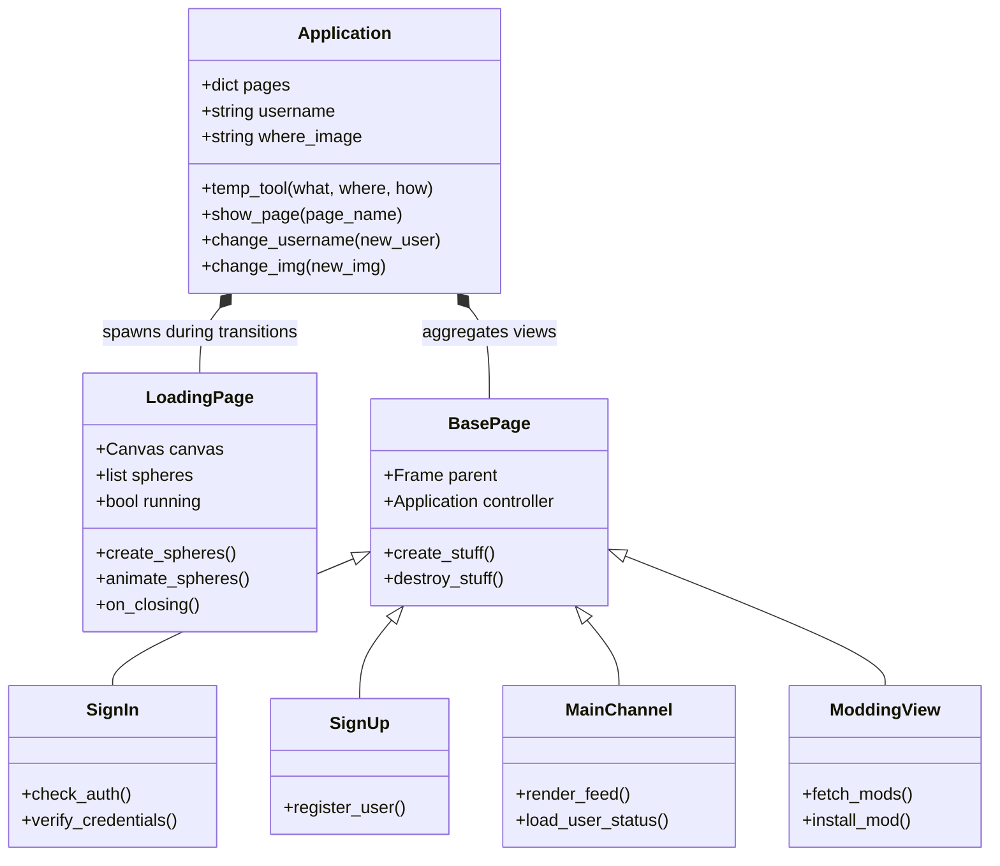

# VLib Architectural Specification

This document details the internal design, threading models, state lifecycle, and data flow of the **VLib (Las Purgas)** desktop client.

---

## 1. High-Level System Architecture

The application is built around a centralized single-window router pattern (`Application(Tk)`), eliminating multi-window clutter and enabling seamless transition between authentication, dashboards, preferences, and modding hubs.

---

## 2. Page Navigation & State Lifecycle

Page switching is coordinated by `Application.show_page(page_name)`:

1. **Unmount Current View:** If an active view exists in `self.pages['current']`, the controller invokes `pack_forget()` followed by `destroy_stuff()` to release Tkinter widget handles, canvas buffers, and image references from memory.
2. **Mount New View:** The target view is fetched from the registry (`self.pages[page_name]`), packed with `pack(fill='both', expand=True)`, and populated via `create_stuff()`.
3. **Reference Update:** The active page reference is updated to point to the newly mounted page instance.

### In-Memory Temporary State Store

During complex multi-step processes (such as multi-screen registration or profile customization), state is passed through `Application.temp_tool(what, where, how)`:
- `what='modify'`: Stores temporary form variables (`temp_username`, `temp_enpasscode`, `temp_birthday`, `temp_description`, `temp_language`, `temp_filestor`, `temp_mail`).
- `what='return'`: Retrieves the current buffered field value.
- `what='reload'`: Clears all temporary buffers upon transaction completion or cancellation.

---

## 3. Asynchronous Sinusoidal Wave Loading Engine

To prevent UI lockups during network operations (database queries, cloud sync), `LoadingPage(Toplevel)` displays an animated particle sequence governed by mathematical sine waves:

$$	ext{position}_y(i, t) = y_0 + A \cdot \sin\left(\omega \cdot \left(rac{2\pi \cdot i}{N} - \omega \cdot t
ight)
ight)$$

Where:
- $A = 15$ px (wave amplitude)
- $\omega = 3.2$ Hz (oscillation frequency)
- $N = 6$ (number of rendered particle spheres)
- $y_0 = 25$ px (baseline canvas center)

The animation runs inside a non-blocking loop with a scheduled micro-delay (`time.sleep(delay / 9000)`), updating coordinate vectors via `canvas.coords()` until the operation signals completion.

---

## 4. Security & Cryptographic Practices

- **Password Storage & Transmission:** Passwords are never persisted in plaintext. Input passcodes are converted to UTF-8 byte arrays and hashed using **SHA-256** (`hashlib.sha256(input_passbytes).hexdigest()`) before database verification.
- **Credential Decoupling:** Database credentials are segregated into `sqldatafile.json` rather than hardcoded in Python logic.
- **Local Session Guard:** `Onl_verification.json` maintains the active user identity token for automatic session reconnection.

---

## 5. Cloud & Storage Adapters

- **Relational Data (MySQL):** Managed via `mysql.connector` connecting to the `users_basicdata` table containing fields `username`, `en_passcode`, and `description`.
- **Object Storage (AWS S3):** Handled via `AWSconn_data.py` for cloud-based mod storage and remote resource retrieval.
- **File Synchronization (Dropbox):** Handled via `dropboxconn.py` using Dropbox OAuth tokens for asset distribution.
