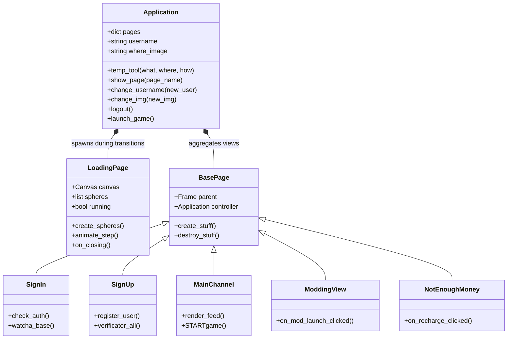

<!-- [2024-DEV Stage 2/4]: docs(arch): document Sinusoidal Wave Loading Engine and Harmonic Equations -->
# VLib Architectural Specification

This document details the internal design, threading models, state lifecycle, and data flow of the **VLib (Las Purgas)** desktop client.

---

## 1. High-Level System Architecture

The application is built around a centralized single-window router pattern (`Application(Tk)`), eliminating multi-window clutter and enabling seamless transition between authentication, dashboards, preferences, billing, and modding hubs.

---

## 2. Page Navigation & State Lifecycle

Page switching is coordinated by `Application.show_page(page_name)`:

1. **Unmount Current View:** If an active view exists in `self.pages['current']`, the controller invokes `pack_forget()` followed by `destroy_stuff()` to release Tkinter widget handles, canvas buffers, audio streams, and image references from memory.
2. **Mount New View:** The target view is fetched from the registry (`self.pages[page_name]`), packed with `pack(fill='both', expand=True)`, and populated via `create_stuff()`.
3. **Reference Update:** The active page reference is updated to point to the newly mounted page instance.
4. **Special Handlers:** Special actions such as `show_page("start_game")` dispatch directly to `Application.launch_game()`, validating the game engine state before safely redirecting back to `main_channel`.

### In-Memory Temporary State Store

During complex multi-step processes (such as multi-screen registration or profile customization), state is passed through `Application.temp_tool(what, where, how)`:
- `what='modify'`: Stores temporary form variables (`temp_username`, `temp_enpasscode`, `temp_birthday`, `temp_description`, `temp_language`, `temp_filestor`, `temp_mail`).
- `what='return'`: Retrieves the current buffered field value.
- `what='reload'`: Clears all temporary buffers upon transaction completion or cancellation.

---

## 3. Non-Blocking Sinusoidal Wave Loading Engine

To prevent UI lockups during network operations (database queries, cloud sync), `LoadingPage(Toplevel)` displays an animated particle sequence governed by mathematical sine waves:

$$\text{position}_y(i, t) = y_0 + A \cdot \sin\left(\omega \cdot \left(\frac{2\pi \cdot i}{N} - \omega \cdot t\right)\right)$$

Where:
- $A = 15$ px (wave amplitude)
- $\omega = 3.2$ Hz (oscillation frequency)
- $N = 6$ (number of rendered particle spheres)
- $y_0 = 25$ px (baseline canvas center)

The animation uses a non-blocking `self.after(33, self.animate_step)` frame scheduler (~30 FPS), eliminating synchronous blocking loops while keeping Tkinter responsive to OS events.

---

## 4. Security & Cryptographic Practices

- **Password Storage & Transmission:** Passwords are never persisted in plaintext. Input passcodes are converted to UTF-8 byte arrays and hashed using **SHA-256** (`hashlib.sha256(input_passbytes).hexdigest()`) before database verification.
- **Offline Authentication Fallback:** The data adapter (`Mycon_basdata`) includes automatic offline fallback to local encrypted credentials (`users.json`), allowing instant testing and offline play without requiring an active MySQL connection.
- **Credential Decoupling:** Environment variables (`.env`) and configuration parameters are loaded with graceful defaults rather than hardcoded credentials.
- **Session Lifecycle & Logout:** `Onl_verification.json` maintains active authentication tokens, automatically updated to `Inactive` upon invoking `Application.logout()`.

---

## 5. Cloud & Storage Adapters

- **Relational Data (MySQL):** Managed via `sqlconn_basdata.py` (`Mycon_basdata`), connecting to the `users_basicdata` / `Vlib` database tables with built-in connection timeouts and local JSON fallback.
- **Object Storage (AWS DynamoDB / S3):** Handled via `AWSconn_data.py` with environment-based credential resolution.
- **File Synchronization (Dropbox):** Handled via `dropboxconn.py` (`DropConn`) with token auto-discovery and offline mocking.
- **Pure Native Image Processing:** Profile avatars support pure Pillow-native rounded corners (`ImageDraw.rounded_rectangle`), generating clean alpha masks without requiring external compiled C libraries (`aggdraw`).

---

## 6. Virtual Economy & Profile Engine

Managed by `ProfileManager` (`profile_manager.py`), handling persistent user states across client sessions:
- **Credits & Multipliers:** Stored in `local_temp_files/user_profile.json`, tracking active currency balances, transaction history, and VIP multipliers.
- **Daily Syndicate Dividend:** 24-hour cooldown timer awarding +250 CR (+500 CR for VIP members) with live balance refresh.
- **Mod Sandbox Registry:** Interactive 4-mod matrix (Re-Shade Neon FX, Radio Deck, Hologram Dice, Fast-Hack Tools) toggled in real time.
- **Synthesized Audio Engine:** Background daemon threads triggering non-blocking sound synthesizer calls (`winsound.Beep`) for clicks, rolls, breaches, and rewards.

---

## 7. Interactive Cyberpunk Casino Arcade

Hosted within `GameSession` (`game_session.py`), offering a dual-mode minigame hub:
- **Neural Cyber-Dice:** Probability-driven 2-cube dice simulation with non-blocking rolling animations. Payout matrix:
  - Critical Doubles: 3.0x Wager
  - Lucky 7 / 11: 2.0x Wager
  - High Node (>= 8): 1.5x Wager
- **Neural Terminal Hack:** Corporate mainframe breach simulation with node selection (Alpha, Beta, Gamma) and real-time hex decryptor trace sequences:
  - Core Vault Breach: 4.0x Jackpot Payout
  - Data Extraction: 2.0x Extraction Payout
  - ICE Countermeasure: Intrusion Blocked

---

## 8. Test Architecture & Quality Gates

The test harness spans 41 automated tests across two test suites:
- `tests/test_vlib.py`: Mathematical models, route registration, page mounting, profile economy, audio toggles, and asset verification.
- `tests/test_cli.py`: Command-line interface argument parsing, version banner validation, diagnostics subsystem health checks, and deep-linking verification.
